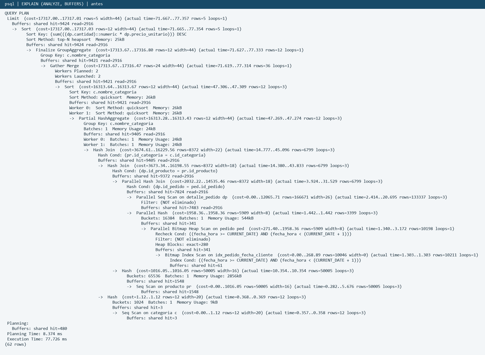
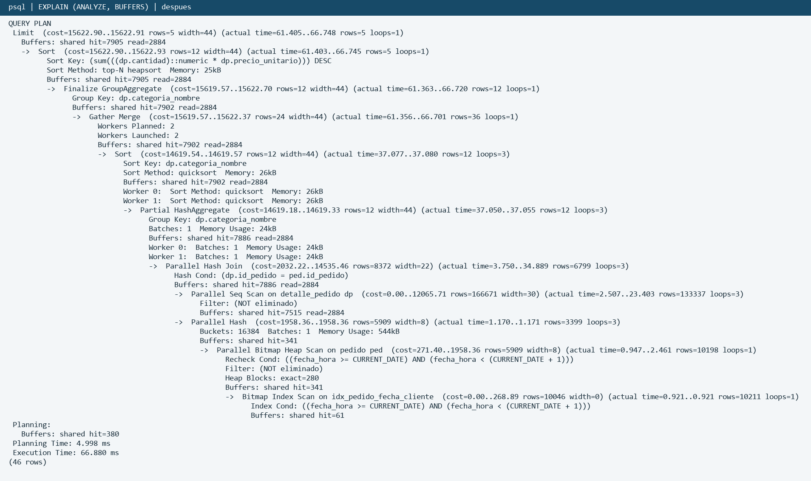

## TP U4 · FNBC y desnormalización controlada

Food Store | Base de Datos II | Comisión 2PRO4 | Docente: Sergio Neira. Integrantes: Tiziano Valentini y Juan Martin Garcia. Corrección y ejecución local: 13/10/2026.

## 1. Dependencias, clausuras y claves (4.2.a-b)

Sea R = {L, D, C}, con L = LoteID, D = DepositoID y C = ResponsableControlID. El relevamiento establece F = {LD -> C, C -> D}. La primera DF fija un responsable por lote y depósito; la segunda fija el depósito al que pertenece cada responsable.

| X | Clausura X+ bajo F | ¿Superclave? |
|---|---|---|
| Vacío | Vacío | No |
| {L} | {L} | No |
| {D} | {D} | No |
| {C} | {C,D} | No |
| {D,C} | {D,C} | No |
| {L,D} | {L,D,C} | Sí |
| {L,C} | {L,C,D} | Sí |
| {L,D,C} | R | Sí, no mínima |

L no aparece a la derecha de ninguna DF y debe integrar toda clave. L solo no alcanza; sumar D o C da una superclave mínima. Por lo tanto, las únicas claves candidatas son {L,D} y {L,C}. Los tres atributos son primos; no hay atributos no primos.

## 2. Violación de FNBC (4.2.c)

FNBC exige que el determinante de toda DF no trivial sea superclave. LD -> C cumple esa condición. C -> D la viola: C+ = {C,D}, que no contiene L. Por eso control_lote_almacen no está en FNBC. Sí está en 3FN: el dependiente D es primo. La definición de 3FN no sustituye la demostración de FNBC.

## 3. Anomalías con la instancia dada (4.2.d)

Inserción. No se puede registrar que el responsable 803 pertenece al depósito 32 sin asignarle un lote: lote_id es parte de la PK y no admite NULL. Un dato maestro de personal queda condicionado a la existencia de un control de lote.

Borrado. Si se elimina (503,31,802), única asignación de 802 en la instancia, también desaparece la información de que ese responsable pertenece al depósito 31. Borrar un control elimina un hecho independiente.

Actualización. El depósito 30 del responsable 801 se repite en (501,30,801) y (502,30,801). Si pasa al depósito 31 deben actualizarse ambas filas; modificar una sola afirmaría que 801 pertenece a dos depósitos y violaría C -> D.

## 4. Descomposición, migración y unión (4.2.e-f)

Sobre C -> D: R1 = {C,D} (responsable_deposito, PK C) y R2 = {L,C} (asignacion_control_lote, PK LC). R1 está en FNBC porque C es clave; R2 no tiene DFs no triviales proyectadas. La intersección es {C}, superclave de R1. Este criterio demuestra la reunión sin pérdida para las instancias originales que satisfacen F.

El script incluye PK, FK hacia lote/deposito/usuario y FK desde R2 a R1, migra con SELECT DISTINCT y crea la vista mediante NATURAL JOIN. La demo usa maestros mínimos dentro de tp_u4_fnbc para no reemplazar tablas del proyecto. Resultado real:

```text
lote_id  deposito_id  responsable_control_id
501      30           801
502      30           801
503      31           802

Original EXCEPT vista: 0 filas
Vista EXCEPT original: 0 filas
Conteos: original = 3; vista = 3
```

La DF LD -> C no se preserva con las PK/FK de las dos tablas: podrían asignarse dos responsables del mismo depósito a un lote. Los disparadores adicionales validan la reunión después de escribir en ambas tablas, con un bloqueo común en READ COMMITTED. Se rechazaron la asignación (501,803) con 803 en depósito 30 y el cambio de 803 al depósito 31 cuando ya controlaba el lote 503. El responsable 803 puede existir sin un lote asignado. Evidencia: salida_parte1.txt.

## 5. Food Store real y diagnóstico (5.2.a)

Se reconstruyó el esquema del repositorio TiziIV/Food-Store-Bd-Valentini-Garcia, commit 24eb62e53a1745eda763c4d9c30ee5350acfddaf. Se ejecutaron la carga de desarrollo, restricciones e índices de TP2-TP5 y sus objetos programables. Es una instancia de prueba del proyecto, no ventas productivas ni las mediciones de ejemplo del PDF.

| Consigna | Adaptación al esquema del proyecto |
|---|---|
| ped.fecha | fecha_hora TIMESTAMPTZ, rango [CURRENT_DATE, CURRENT_DATE+1) |
| dp.subtotal | cantidad * precio_unitario |
| id / categoria_id / producto_id / pedido_id | id_categoria / id_producto / id_pedido |
| c.nombre | nombre_categoria |

PostgreSQL 16.15, Windows de 64 bits. Zona: America/Argentina/Buenos_Aires; shared_buffers=128MB; work_mem=4MB; max_parallel_workers_per_gather=2. Volumen: 20.003 clientes, 12 categorías, 50.005 productos, 200.003 pedidos y 400.011 detalles. El preparador concentra uno de cada veinte pedidos en el día actual: 10.198 pedidos y 20.396 detalles vigentes el 13/10/2026.

La corrida inicial normalizada dio 90,742 ms. El plan posterior comparable del anexo dio 77,726 ms: Parallel Seq Scan recorre 400.011 detalles entre tres participantes; Parallel Hash Join filtra por pedidos del día y los Hash Join adicionales incorporan el catálogo. El scan del detalle y las reuniones concentran el trabajo; el Seq Scan de Producto también lee 50.005 filas. No se suman los tiempos inclusivos de los nodos ni se confunden con tiempos propios. Categoria tiene solo 12 filas y su lectura es pequeña.

## 6. Patrón elegido y sincronización (5.2.b-c)

Se elige columna precalculada con disparadores: Detalle_Pedido.categoria_nombre, porque el plan medido muestra trabajo sobre el detalle y reuniones repetidas con el catálogo, y la mediana baja de 77,258 a 65,942 ms al eliminar dos reuniones. Un trigger recalcula el nombre al insertar o modificar el producto/valor redundante de un detalle; otros propagan renombres de categoría y reclasificaciones de producto en la misma transacción. Un bloqueo transaccional común antes de escribir en las tres fuentes evita carreras en READ COMMITTED. El patrón es reversible sin pérdida: eliminar la columna y sus disparadores conserva todos los datos fuente. Asume espacio y costo de propagación adicionales, serializa escrituras y mantiene el reporte con la categoría vigente del producto.

Instalación atómica: bloqueo de fuentes, alta de columna, carga inicial, NOT NULL y creación de disparadores dentro de BEGIN/COMMIT. Se validó primero con ROLLBACK y se hizo respaldo previo. La consulta nueva conserva Pedido para filtrar fecha y baja lógica; no duplica fecha ni subtotal. Los triggers anteriores de stock y detalle se conservaron.

## 7. Comparación y verificación (5.2.d-e)

| Antes: cuatro tablas | Después: dos tablas |
|---|---|
| Captura completa: 77,726 ms | Captura completa: 66,880 ms |
| Mediana de 7: 77,258 ms | Mediana de 7: 65,942 ms |
| Nodo de lectura dominante: Parallel Seq Scan de detalle; Parallel Hash Join y dos Hash Join de catálogo | Nodo de lectura dominante: Parallel Seq Scan de detalle y Parallel Hash Join con Pedido |
| Detalle + Pedido + Producto + Categoria | Detalle + Pedido; categoria_nombre ya está en el detalle |

Se alternó el orden de las dos consultas en siete pares, después de un calentamiento y de VACUUM/ANALYZE, sin cambiar filas, índices ni parámetros entre consultas. Se comparó la consulta normalizada contra la nueva sobre el mismo estado físico después de la migración. Reducción de la mediana: 14,65% (factor 1,17). Las capturas son corridas adicionales y sus tiempos no son las medianas.

Tiempos antes (ms): 77,238; 77,258; 77,060; 78,219; 91,358; 77,333; 77,157. Después: 65,942; 65,614; 65,639; 147,232; 64,903; 65,942; 149,024. Hay dos valores atípicos en el después; no se eliminaron. Hubo shared read incluso tras el calentamiento. Es evidencia local de una mejora típica, con variabilidad, y no una garantía de latencia en producción.

El reporte nuevo agrupa por categoria_nombre y suma cantidad*precio_unitario, con los mismos filtros y LIMIT 5. EXCEPT ALL en ambos sentidos sobre todos los grupos del día dio 0 diferencias. La auditoría compara cada nombre redundante contra Producto JOIN Categoria con IS DISTINCT FROM: devolvió 0 filas. Los dos top 5 también coincidieron.

| Categoría | Monto vendido (instancia medida) |
|---|---|
| Lácteos | 14.000.980,11 |
| Congelados | 12.963.610,26 |
| Almacén | 12.483.957,10 |
| Frutas y Verduras | 12.053.409,22 |
| Snacks | 12.021.348,87 |

Las nueve pruebas reversibles cubrieron inserción con nombre falso, edición directa, cambio de producto, reclasificación, renombre con nombres repetidos, baja de detalle, baja de pedido, cambio de día y borrado en cascada: auditoría=0 y diferencias=0 en cada paso. En dos sesiones concurrentes, B esperó 4,022 s por A y derivó el nombre ya confirmado; auditoría global=0. Evidencia: pruebas_integridad.txt y prueba_concurrencia.txt.

Límites: sigue el recorrido de detalle; un renombre puede actualizar muchas filas. El bloqueo reduce concurrencia de escrituras y se rechazan aislamientos distintos de READ COMMITTED. No se midió throughput de escrituras. La garantía requiere triggers habilitados. Fuentes técnicas: PostgreSQL 16, Trigger Functions y Overview of Trigger Behavior (postgresql.org/docs/16/plpgsql-trigger.html y trigger-definition.html).

## Anexos: planes completos

Las imágenes renderizan las salidas reales de psql, conservando todos los nodos y métricas.



```text
QUERY PLAN
-------------------------------------------------------------------------------------------------------------------------------------------------------------------------------------------------------
 Limit  (cost=17317.00..17317.01 rows=5 width=44) (actual time=71.667..77.357 rows=5 loops=1)
   Buffers: shared hit=9424 read=2916
   ->  Sort  (cost=17317.00..17317.03 rows=12 width=44) (actual time=71.665..77.354 rows=5 loops=1)
         Sort Key: (sum(((dp.cantidad)::numeric * dp.precio_unitario))) DESC
         Sort Method: top-N heapsort  Memory: 25kB
         Buffers: shared hit=9424 read=2916
         ->  Finalize GroupAggregate  (cost=17313.67..17316.80 rows=12 width=44) (actual time=71.627..77.333 rows=12 loops=1)
               Group Key: c.nombre_categoria
               Buffers: shared hit=9421 read=2916
               ->  Gather Merge  (cost=17313.67..17316.47 rows=24 width=44) (actual time=71.619..77.314 rows=36 loops=1)
                     Workers Planned: 2
                     Workers Launched: 2
                     Buffers: shared hit=9421 read=2916
                     ->  Sort  (cost=16313.64..16313.67 rows=12 width=44) (actual time=47.306..47.309 rows=12 loops=3)
                           Sort Key: c.nombre_categoria
                           Sort Method: quicksort  Memory: 26kB
                           Buffers: shared hit=9421 read=2916
                           Worker 0:  Sort Method: quicksort  Memory: 26kB
                           Worker 1:  Sort Method: quicksort  Memory: 26kB
                           ->  Partial HashAggregate  (cost=16313.28..16313.43 rows=12 width=44) (actual time=47.269..47.274 rows=12 loops=3)
                                 Group Key: c.nombre_categoria
                                 Batches: 1  Memory Usage: 24kB
                                 Buffers: shared hit=9405 read=2916
                                 Worker 0:  Batches: 1  Memory Usage: 24kB
                                 Worker 1:  Batches: 1  Memory Usage: 24kB
                                 ->  Hash Join  (cost=3674.61..16229.56 rows=8372 width=22) (actual time=14.777..45.096 rows=6799 loops=3)
                                       Hash Cond: (pr.id_categoria = c.id_categoria)
                                       Buffers: shared hit=9405 read=2916
                                       ->  Hash Join  (cost=3673.34..16198.55 rows=8372 width=18) (actual time=14.380..43.833 rows=6799 loops=3)
                                             Hash Cond: (dp.id_producto = pr.id_producto)
                                             Buffers: shared hit=9372 read=2916
                                             ->  Parallel Hash Join  (cost=2032.22..14535.46 rows=8372 width=18) (actual time=3.924..31.529 rows=6799 loops=3)
                                                   Hash Cond: (dp.id_pedido = ped.id_pedido)
                                                   Buffers: shared hit=7824 read=2916
                                                   ->  Parallel Seq Scan on detalle_pedido dp  (cost=0.00..12065.71 rows=166671 width=26) (actual time=2.414..20.695 rows=133337 loops=3)
                                                         Filter: (NOT eliminado)
                                                         Buffers: shared hit=7483 read=2916
                                                   ->  Parallel Hash  (cost=1958.36..1958.36 rows=5909 width=8) (actual time=1.442..1.442 rows=3399 loops=3)
                                                         Buckets: 16384  Batches: 1  Memory Usage: 544kB
                                                         Buffers: shared hit=341
                                                         ->  Parallel Bitmap Heap Scan on pedido ped  (cost=271.40..1958.36 rows=5909 width=8) (actual time=1.340..3.172 rows=10198 loops=1)
                                                               Recheck Cond: ((fecha_hora >= CURRENT_DATE) AND (fecha_hora < (CURRENT_DATE + 1)))
                                                               Filter: (NOT eliminado)
                                                               Heap Blocks: exact=280
                                                               Buffers: shared hit=341
                                                               ->  Bitmap Index Scan on idx_pedido_fecha_cliente  (cost=0.00..268.89 rows=10046 width=0) (actual time=1.303..1.303 rows=10211 loops=1)
                                                                     Index Cond: ((fecha_hora >= CURRENT_DATE) AND (fecha_hora < (CURRENT_DATE + 1)))
                                                                     Buffers: shared hit=61
                                             ->  Hash  (cost=1016.05..1016.05 rows=50005 width=16) (actual time=10.354..10.354 rows=50005 loops=3)
                                                   Buckets: 65536  Batches: 1  Memory Usage: 2856kB
                                                   Buffers: shared hit=1548
                                                   ->  Seq Scan on producto pr  (cost=0.00..1016.05 rows=50005 width=16) (actual time=0.282..5.676 rows=50005 loops=3)
                                                         Buffers: shared hit=1548
                                       ->  Hash  (cost=1.12..1.12 rows=12 width=20) (actual time=0.368..0.369 rows=12 loops=3)
                                             Buckets: 1024  Batches: 1  Memory Usage: 9kB
                                             Buffers: shared hit=3
                                             ->  Seq Scan on categoria c  (cost=0.00..1.12 rows=12 width=20) (actual time=0.357..0.358 rows=12 loops=3)
                                                   Buffers: shared hit=3
 Planning:
   Buffers: shared hit=480
 Planning Time: 8.374 ms
 Execution Time: 77.726 ms
(62 rows)

```

## Anexos: planes completos

Las imágenes renderizan las salidas reales de psql, conservando todos los nodos y métricas.



```text
QUERY PLAN
-------------------------------------------------------------------------------------------------------------------------------------------------------------------------------------------
 Limit  (cost=15622.90..15622.91 rows=5 width=44) (actual time=61.405..66.748 rows=5 loops=1)
   Buffers: shared hit=7905 read=2884
   ->  Sort  (cost=15622.90..15622.93 rows=12 width=44) (actual time=61.403..66.745 rows=5 loops=1)
         Sort Key: (sum(((dp.cantidad)::numeric * dp.precio_unitario))) DESC
         Sort Method: top-N heapsort  Memory: 25kB
         Buffers: shared hit=7905 read=2884
         ->  Finalize GroupAggregate  (cost=15619.57..15622.70 rows=12 width=44) (actual time=61.363..66.720 rows=12 loops=1)
               Group Key: dp.categoria_nombre
               Buffers: shared hit=7902 read=2884
               ->  Gather Merge  (cost=15619.57..15622.37 rows=24 width=44) (actual time=61.356..66.701 rows=36 loops=1)
                     Workers Planned: 2
                     Workers Launched: 2
                     Buffers: shared hit=7902 read=2884
                     ->  Sort  (cost=14619.54..14619.57 rows=12 width=44) (actual time=37.077..37.080 rows=12 loops=3)
                           Sort Key: dp.categoria_nombre
                           Sort Method: quicksort  Memory: 26kB
                           Buffers: shared hit=7902 read=2884
                           Worker 0:  Sort Method: quicksort  Memory: 26kB
                           Worker 1:  Sort Method: quicksort  Memory: 26kB
                           ->  Partial HashAggregate  (cost=14619.18..14619.33 rows=12 width=44) (actual time=37.050..37.055 rows=12 loops=3)
                                 Group Key: dp.categoria_nombre
                                 Batches: 1  Memory Usage: 24kB
                                 Buffers: shared hit=7886 read=2884
                                 Worker 0:  Batches: 1  Memory Usage: 24kB
                                 Worker 1:  Batches: 1  Memory Usage: 24kB
                                 ->  Parallel Hash Join  (cost=2032.22..14535.46 rows=8372 width=22) (actual time=3.750..34.889 rows=6799 loops=3)
                                       Hash Cond: (dp.id_pedido = ped.id_pedido)
                                       Buffers: shared hit=7886 read=2884
                                       ->  Parallel Seq Scan on detalle_pedido dp  (cost=0.00..12065.71 rows=166671 width=30) (actual time=2.507..23.403 rows=133337 loops=3)
                                             Filter: (NOT eliminado)
                                             Buffers: shared hit=7515 read=2884
                                       ->  Parallel Hash  (cost=1958.36..1958.36 rows=5909 width=8) (actual time=1.170..1.171 rows=3399 loops=3)
                                             Buckets: 16384  Batches: 1  Memory Usage: 544kB
                                             Buffers: shared hit=341
                                             ->  Parallel Bitmap Heap Scan on pedido ped  (cost=271.40..1958.36 rows=5909 width=8) (actual time=0.947..2.461 rows=10198 loops=1)
                                                   Recheck Cond: ((fecha_hora >= CURRENT_DATE) AND (fecha_hora < (CURRENT_DATE + 1)))
                                                   Filter: (NOT eliminado)
                                                   Heap Blocks: exact=280
                                                   Buffers: shared hit=341
                                                   ->  Bitmap Index Scan on idx_pedido_fecha_cliente  (cost=0.00..268.89 rows=10046 width=0) (actual time=0.921..0.921 rows=10211 loops=1)
                                                         Index Cond: ((fecha_hora >= CURRENT_DATE) AND (fecha_hora < (CURRENT_DATE + 1)))
                                                         Buffers: shared hit=61
 Planning:
   Buffers: shared hit=380
 Planning Time: 4.998 ms
 Execution Time: 66.880 ms
(46 rows)

```
