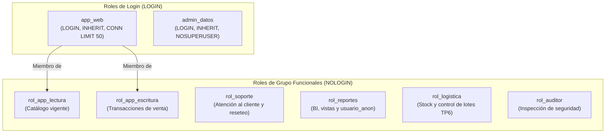

# Especificación de Diseño (Kiro) — Arquitectura RBAC y Matriz de Privilegios

**Proyecto:** Food Store — Base de Datos II (Unidad 5: Administración y Seguridad)  
**Motor de referencia:** PostgreSQL 16+ (verificado en PostgreSQL 18.3)  
**Autores:** Tiziano Valentini y Juan Martin Garcia  
**Archivo de implementación:** [`sql/roles.sql`](../../sql/roles.sql)  

---

## 1. Arquitectura de Identidades y Herencia

El diseño separa estrictamente **qué se puede hacer** (roles de grupo sin login, `NOLOGIN`) de **quién se conecta** (roles de inicio de sesión, `LOGIN`). Esta separación permite rotar credenciales o sumar servicios de aplicación sin reescribir la matriz de `GRANT` sobre las tablas.



---

## 2. Diseño de la Tabla `usuario` y Funciones de Seguridad

Dado que el esquema original de `TP1_FoodStore/schema.sql` modeló la entidad comercial `Cliente` (sin credenciales de acceso) y en `TP6_FNBC_Desnormalizacion` se introdujo la tabla maestra `usuario(id, nombre)` para los inspectores de almacén, el diseño de la Unidad 5 unifica y amplía de manera **100% idempotente** la entidad `public.usuario`:

### 2.1. Estructura de `public.usuario`
| Columna | Tipo | Restricciones | Nivel de Sensibilidad |
|---|---|---|---|
| `id` | `BIGINT` | `GENERATED BY DEFAULT AS IDENTITY PRIMARY KEY` | Público interno (FK desde control de lotes) |
| `nombre` | `VARCHAR(120)` | `NOT NULL` | Dato personal identificable (PII) — se anonimiza en `usuario_anon` |
| `email` | `VARCHAR(150)` | `NOT NULL UNIQUE`, formato email válido | Dato personal identificable (PII) — se anonimiza en `usuario_anon` |
| `password_hash` | `TEXT` | `NOT NULL` (hash bcrypt/SHA-256 con salt) | **Secreto crítico** — excluido de todo `GRANT SELECT` por columna |
| `rol` | `VARCHAR(40)` | `NOT NULL DEFAULT 'cliente'`, `CHECK (rol IN ('cliente','soporte','logistica','reportes','auditor','admin'))` | Atributo operativo — se preserva en `usuario_anon` |
| `fecha_alta` | `TIMESTAMPTZ` | `NOT NULL DEFAULT now()` | Atributo analítico temporal — se preserva en `usuario_anon` |

### 2.2. Funciones de Autenticación y Reseteo (`SECURITY DEFINER`)
Para cumplir el principio de mínimo privilegio sin exponer `password_hash`:
- **`fn_autenticar(p_email VARCHAR, p_password TEXT)`**:
  - Se ejecuta con privilegios del propietario (`SECURITY DEFINER`) y `SET search_path = public, pg_temp`.
  - Compara el hash almacenado con el hash de `p_password`.
  - Si coincide, retorna `(autenticado = TRUE, usuario_id, rol_usuario)` y emite un registro informativo; si falla, emite `RAISE WARNING 'Fallo de autenticacion para el email: %', p_email` (lo que garantiza trazabilidad en el log del servidor incluso bajo invocación SQL) y retorna `(FALSE, NULL, NULL)`.
  - Se otorga `EXECUTE` únicamente a `rol_app_escritura` (heredado por `app_web`) y `admin_datos`.
- **`fn_resetear_password(p_usuario_id BIGINT, p_nueva_password TEXT)`**:
  - Se ejecuta como `SECURITY DEFINER` con `SET search_path = public, pg_temp`.
  - Verifica longitud mínima de contraseña, actualiza `password_hash` aplicando hash criptográfico y registra en el log qué rol ejecutó el blanqueo (`SESSION_USER` / `CURRENT_USER`).
  - Se otorga `EXECUTE` únicamente a `rol_soporte` y `admin_datos`.

---

## 3. Matriz Exacta de Privilegios por Rol

Antes de aplicar cualquier permiso, se revocan los privilegios por defecto de `PUBLIC` sobre el esquema, tablas, secuencias y rutinas.

### 3.1. Privilegios sobre Tablas y Vistas (`public`)

| Objeto | Tipo | `rol_app_lectura` | `rol_app_escritura` | `rol_soporte` | `rol_reportes` | `rol_logistica` | `rol_auditor` | `admin_datos` |
|---|---|---|---|---|---|---|---|---|
| `categoria` | Tabla | `SELECT` | `SELECT` | `SELECT` | — | `SELECT` | — | `SELECT, INSERT, UPDATE, DELETE, TRUNCATE, REFERENCES, TRIGGER` |
| `producto` | Tabla | `SELECT` | `SELECT, UPDATE` | `SELECT` | — | `SELECT`, `UPDATE (stock, activo)` | — | `ALL` |
| `cliente` | Tabla | — | `SELECT, INSERT, UPDATE` | `SELECT (id_cliente, nombre, correo, eliminado, created_at)` | — | — | — | `ALL` |
| `pedido` | Tabla | — | `SELECT, INSERT, UPDATE` | `SELECT` | — | — | — | `ALL` |
| `detalle_pedido` | Tabla | — | `SELECT, INSERT, UPDATE` | `SELECT` | — | — | — | `ALL` |
| `usuario` | Tabla | `SELECT (id, nombre, email, rol, fecha_alta)` | — | `SELECT (id, nombre, email, rol, fecha_alta)` | — | — | `SELECT (id, nombre, email, rol, fecha_alta)` | `ALL` |
| `usuario_anon` | Tabla | — | — | — | `SELECT` | — | `SELECT` | `ALL` |
| `lote`, `deposito`, `control_lote_almacen`, `responsable_deposito`, `asignacion_control_lote` | Tablas TP6 | — | — | — | — | `SELECT, INSERT, UPDATE` | `SELECT` | `ALL` |
| `vista_productos_vigentes` | Vista | `SELECT` | — | `SELECT` | `SELECT` | `SELECT` | — | `ALL` |
| `vista_pedidos_cliente` | Vista | — | — | `SELECT` | `SELECT` | — | `SELECT` | `ALL` |
| `vista_detalle_pedido_producto` | Vista | — | — | `SELECT` | `SELECT` | `SELECT` | — | `ALL` |
| `vista_control_lote_almacen_fnbc` | Vista | — | — | — | — | `SELECT` | `SELECT` | `ALL` |
| `mv_facturacion_categoria_mes` | Vista Mat. | — | — | — | `SELECT` | — | — | `ALL` |

### 3.2. Privilegios sobre Secuencias y Rutinas

| Objeto | Tipo | Roles con Privilegio | Privilegio Otorgado | Justificación |
|---|---|---|---|---|
| Secuencias `IDENTITY` de `cliente`, `pedido`, `usuario` | Secuencia | `rol_app_escritura`, `admin_datos` | `USAGE, SELECT` | Necesario para generar IDs al insertar pedidos y clientes nuevos. |
| `fn_autenticar(varchar, text)` | Función | `rol_app_escritura`, `admin_datos` | `EXECUTE` | Permite al backend autenticar sin leer `usuario.password_hash`. |
| `fn_resetear_password(bigint, text)` | Función | `rol_soporte`, `admin_datos` | `EXECUTE` | Permite a soporte blanquear claves sin `UPDATE` directo sobre `usuario`. |
| `fn_total_pedido(bigint)` | Función | `rol_app_lectura`, `rol_app_escritura`, `rol_soporte`, `rol_reportes`, `admin_datos` | `EXECUTE` | Cálculo de total vigente de un pedido. |
| `sp_registrar_pedido(...)` | Procedimiento | `rol_app_escritura`, `admin_datos` | `EXECUTE` | Registro transaccional atómico de pedidos. |
| `sp_anular_pedido(bigint)` | Procedimiento | `rol_app_escritura`, `rol_soporte`, `admin_datos` | `EXECUTE` | Anulación lógica con devolución de stock. |
| `sp_dar_baja_cliente(bigint)` | Procedimiento | `rol_soporte`, `admin_datos` | `EXECUTE` | Baja lógica controlada de clientes. |

---

## 4. Política de Privilegios por Defecto (`ALTER DEFAULT PRIVILEGES`)

Para garantizar que la creación de tablas futuras en el esquema `public` no requiera intervención manual ni quede abierta a `PUBLIC`, se configura:

```sql
ALTER DEFAULT PRIVILEGES FOR ROLE postgres IN SCHEMA public
    REVOKE ALL ON TABLES FROM PUBLIC;

ALTER DEFAULT PRIVILEGES FOR ROLE postgres IN SCHEMA public
    GRANT SELECT ON TABLES TO rol_app_lectura;

ALTER DEFAULT PRIVILEGES FOR ROLE postgres IN SCHEMA public
    GRANT SELECT, INSERT, UPDATE ON TABLES TO rol_app_escritura;

ALTER DEFAULT PRIVILEGES FOR ROLE postgres IN SCHEMA public
    GRANT ALL PRIVILEGES ON TABLES TO admin_datos;

ALTER DEFAULT PRIVILEGES FOR ROLE postgres IN SCHEMA public
    GRANT USAGE, SELECT ON SEQUENCES TO rol_app_escritura, admin_datos;
```
*(Se replica la misma directiva `FOR ROLE admin_datos IN SCHEMA public` para cubrir objetos creados directamente por el administrador de datos).*

---

## 5. Plan y Evidencia de Verificación (Parte A.3)

1. **Inspección de atributos de roles (`\du`)**: se confirmó que `rol_app_lectura`, `rol_app_escritura`, `rol_soporte`, `rol_reportes`, `rol_logistica` y `rol_auditor` poseen `canlogin = f`, y que `app_web` hereda únicamente `{rol_app_escritura, rol_app_lectura}`.
2. **Inspección de catálogo (`information_schema.role_table_grants` y `information_schema.column_privileges`)**: se verificó que no existen permisos residuales hacia `PUBLIC` y que `usuario` solo expone las 5 columnas no sensibles (`id, nombre, email, rol, fecha_alta`).
3. **Pruebas negativas de control de acceso**: se verificó que `SET ROLE rol_soporte; SELECT password_hash FROM usuario;` falla con `ERROR: permiso denegado a la tabla usuario`.

### 5.1. Salida verificada de `\du` y atributos de roles
```text
        rol        | superuser | inherit | createrole | createdb | canlogin | connlimit |             miembro_de              
-------------------+-----------+---------+------------+----------+----------+-----------+-------------------------------------
 admin_datos       | f         | t       | f          | f        | t        |        10 | {}
 app_web           | f         | t       | f          | f        | t        |        50 | {rol_app_escritura,rol_app_lectura}
 postgres          | t         | t       | t          | t        | t        |        -1 | {}
 rol_app_escritura | f         | t       | f          | f        | f        |        -1 | {}
 rol_app_lectura   | f         | t       | f          | f        | f        |        -1 | {}
 rol_auditor       | f         | t       | f          | f        | f        |        -1 | {}
 rol_logistica     | f         | t       | f          | f        | f        |        -1 | {}
 rol_reportes      | f         | t       | f          | f        | f        |        -1 | {}
 rol_soporte       | f         | t       | f          | f        | f        |        -1 | {}
(9 filas)
```

### 5.2. Salida verificada de `information_schema.role_table_grants`
```text
      grantee      | table_schema |           table_name            | privilege_type | is_grantable 
-------------------+--------------+---------------------------------+----------------+--------------
 rol_app_escritura | public       | categoria                       | SELECT         | NO
 rol_app_escritura | public       | cliente                         | INSERT         | NO
 rol_app_escritura | public       | cliente                         | SELECT         | NO
 rol_app_escritura | public       | cliente                         | UPDATE         | NO
 rol_app_escritura | public       | detalle_pedido                  | INSERT         | NO
 rol_app_escritura | public       | detalle_pedido                  | SELECT         | NO
 rol_app_escritura | public       | detalle_pedido                  | UPDATE         | NO
 rol_app_escritura | public       | pedido                          | INSERT         | NO
 rol_app_escritura | public       | pedido                          | SELECT         | NO
 rol_app_escritura | public       | pedido                          | UPDATE         | NO
 rol_app_escritura | public       | producto                        | SELECT         | NO
 rol_app_escritura | public       | producto                        | UPDATE         | NO
 rol_app_lectura   | public       | categoria                       | SELECT         | NO
 rol_app_lectura   | public       | producto                        | SELECT         | NO
 rol_app_lectura   | public       | vista_productos_vigentes        | SELECT         | NO
 rol_auditor       | public       | usuario_anon                    | SELECT         | NO
 rol_auditor       | public       | vista_control_lote_almacen_fnbc | SELECT         | NO
 rol_auditor       | public       | vista_pedidos_cliente           | SELECT         | NO
 rol_logistica     | public       | asignacion_control_lote         | INSERT         | NO
 rol_logistica     | public       | asignacion_control_lote         | SELECT         | NO
 rol_logistica     | public       | asignacion_control_lote         | UPDATE         | NO
 rol_logistica     | public       | categoria                       | SELECT         | NO
 rol_logistica     | public       | control_lote_almacen            | INSERT         | NO
 rol_logistica     | public       | control_lote_almacen            | SELECT         | NO
 rol_logistica     | public       | control_lote_almacen            | UPDATE         | NO
 rol_logistica     | public       | deposito                        | INSERT         | NO
 rol_logistica     | public       | deposito                        | SELECT         | NO
 rol_logistica     | public       | deposito                        | UPDATE         | NO
 rol_logistica     | public       | lote                            | INSERT         | NO
 rol_logistica     | public       | lote                            | SELECT         | NO
 rol_logistica     | public       | lote                            | UPDATE         | NO
 rol_logistica     | public       | producto                        | SELECT         | NO
 rol_logistica     | public       | responsable_deposito            | INSERT         | NO
 rol_logistica     | public       | responsable_deposito            | SELECT         | NO
 rol_logistica     | public       | responsable_deposito            | UPDATE         | NO
 rol_logistica     | public       | vista_control_lote_almacen_fnbc | SELECT         | NO
 rol_logistica     | public       | vista_detalle_pedido_producto   | SELECT         | NO
 rol_logistica     | public       | vista_productos_vigentes        | SELECT         | NO
 rol_reportes      | public       | usuario_anon                    | SELECT         | NO
 rol_reportes      | public       | vista_detalle_pedido_producto   | SELECT         | NO
 rol_reportes      | public       | vista_pedidos_cliente           | SELECT         | NO
 rol_reportes      | public       | vista_productos_vigentes        | SELECT         | NO
 rol_soporte       | public       | categoria                       | SELECT         | NO
 rol_soporte       | public       | detalle_pedido                  | SELECT         | NO
 rol_soporte       | public       | pedido                          | SELECT         | NO
 rol_soporte       | public       | producto                        | SELECT         | NO
 rol_soporte       | public       | vista_detalle_pedido_producto   | SELECT         | NO
 rol_soporte       | public       | vista_pedidos_cliente           | SELECT         | NO
 rol_soporte       | public       | vista_productos_vigentes        | SELECT         | NO
```

### 5.3. Salida verificada de `information_schema.column_privileges` (Permisos a nivel de columna)
```text
     grantee     | table_name |   column_name   | privilege_type 
-----------------+------------+-----------------+----------------
 rol_app_lectura | usuario    | email           | SELECT
 rol_app_lectura | usuario    | fecha_alta      | SELECT
 rol_app_lectura | usuario    | id              | SELECT
 rol_app_lectura | usuario    | nombre          | SELECT
 rol_app_lectura | usuario    | rol             | SELECT
 rol_auditor     | usuario    | email           | SELECT
 rol_auditor     | usuario    | fecha_alta      | SELECT
 rol_auditor     | usuario    | id              | SELECT
 rol_auditor     | usuario    | nombre          | SELECT
 rol_auditor     | usuario    | rol             | SELECT
 rol_logistica   | producto   | activo          | UPDATE
 rol_logistica   | producto   | stock           | UPDATE
 rol_soporte     | cliente    | correo          | SELECT
 rol_soporte     | cliente    | created_at      | SELECT
 rol_soporte     | cliente    | eliminado       | SELECT
 rol_soporte     | cliente    | id_cliente      | SELECT
 rol_soporte     | cliente    | nombre          | SELECT
 rol_soporte     | usuario    | email           | SELECT
 rol_soporte     | usuario    | fecha_alta      | SELECT
 rol_soporte     | usuario    | id              | SELECT
 rol_soporte     | usuario    | nombre          | SELECT
 rol_soporte     | usuario    | rol             | SELECT
```
